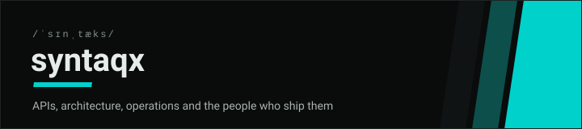
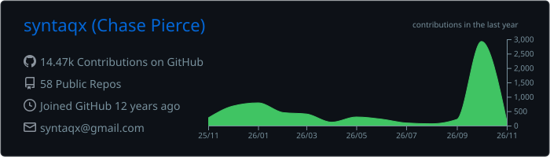
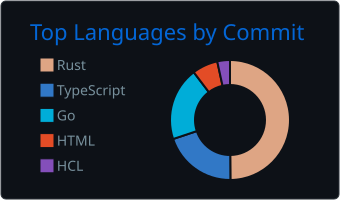
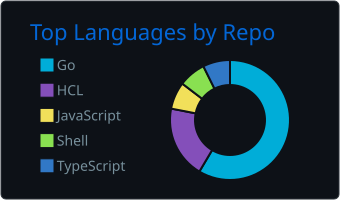

  <a href="https://www.syntaqx.com/docs/playbook"><b>Playbook</b></a> ·
  <a href="https://www.syntaqx.com/posts"><b>Posts</b></a> ·
  <a href="https://www.syntaqx.com/books"><b>Books</b></a> ·
  <a href="https://www.syntaqx.com/tools"><b>Tools</b></a> ·
  <a href="https://www.syntaqx.com/ui"><b>UI</b></a> ·
  <a href="https://www.syntaqx.com/projects"><b>Projects</b></a> ·
  <a href="https://www.syntaqx.com/about"><b>About</b></a> ·
  <a href="https://www.syntaqx.com/resume"><b>Résumé</b></a>

## ✍️ Recent posts

<table>
  <tr><td><a href="https://www.syntaqx.com/posts/building-it-isnt-owning-it">Building It Isn't Owning It</a></td><td>Anyone can build an app over a weekend now. Owning it is the part that costs.</td></tr>
  <tr><td><a href="https://www.syntaqx.com/posts/weve-been-vibe-coding-this-whole-time">We've Been "Vibe Coding" This Whole Time</a></td><td>Every promotion moved you further from the code. Now every engineer gets a small org chart.</td></tr>
  <tr><td><a href="https://www.syntaqx.com/posts/we-called-it-progress">We Called It Progress</a></td><td>Decades of software that made other people's jobs cheaper. Now it's happening to us.</td></tr>
  <tr><td><a href="https://www.syntaqx.com/posts/control-isnt-success">Control Isn't Success</a></td><td>Shipping a CRM rebuild a year early, then breaking everything else.</td></tr>
  <tr><td><a href="https://www.syntaqx.com/posts/the-thinking-tax">The Thinking Tax</a></td><td>What goes missing when the tool thinks first.</td></tr>
</table>

[All posts →](https://www.syntaqx.com/posts)

## 📘 The Playbook

Standards for building software, from HTTP fundamentals to leading the team.
**[Start here →](https://www.syntaqx.com/docs/playbook)**

**Most read:**
[API design principles](https://www.syntaqx.com/docs/api-design/principles) ·
[API naming conventions](https://www.syntaqx.com/docs/api-design/naming-conventions) ·
[Pagination](https://www.syntaqx.com/docs/requests/pagination) ·
[Error responses](https://www.syntaqx.com/docs/requests/error-responses) ·
[Idempotency](https://www.syntaqx.com/docs/requests/idempotency) ·
[Database naming conventions](https://www.syntaqx.com/docs/database/naming-conventions)

| Foundations | Building | Running | People |
| --- | --- | --- | --- |
| [Fundamentals](https://www.syntaqx.com/docs/fundamentals/rest-http-verbs) | [Architecture](https://www.syntaqx.com/docs/architecture/service-boundaries) | [Delivery](https://www.syntaqx.com/docs/delivery/ci-pipelines) | [Product](https://www.syntaqx.com/docs/product/discovery) |
| [API design](https://www.syntaqx.com/docs/api-design/principles) | [Building blocks](https://www.syntaqx.com/docs/building-blocks/audit-trails) | [Operations](https://www.syntaqx.com/docs/operations/environments) | [Development](https://www.syntaqx.com/docs/development/design-docs) |
| [Requests](https://www.syntaqx.com/docs/requests/json-conventions) | [Frontend](https://www.syntaqx.com/docs/frontend/accessibility) | [Observability](https://www.syntaqx.com/docs/observability/overview) | [Leadership](https://www.syntaqx.com/docs/leadership/hiring) |
| [Database](https://www.syntaqx.com/docs/database/naming-conventions) | [Money](https://www.syntaqx.com/docs/money/amounts) | [Telemetry](https://www.syntaqx.com/docs/telemetry/event-design) | |
| [Data](https://www.syntaqx.com/docs/data/separating-production-and-analytics) | [Security](https://www.syntaqx.com/docs/security/threat-modeling) | [Quality](https://www.syntaqx.com/docs/quality/strategy) | |
| | [Compliance](https://www.syntaqx.com/docs/compliance/pci-dss) | | |

## 📚 Books

Long reads that apply the playbook to one industry at a time: how its rules, money and regulators shape the systems you build.

<table>
  <tr>
    <td><a href="https://www.syntaqx.com/books/banking-and-lending">Banking &amp; Lending</a></td>
    <td><a href="https://www.syntaqx.com/books/commerce">Commerce</a></td>
    <td><a href="https://www.syntaqx.com/books/field-operations">Field Operations</a></td>
  </tr>
  <tr>
    <td><a href="https://www.syntaqx.com/books/gaming">Gaming</a></td>
    <td><a href="https://www.syntaqx.com/books/health-tech">Health Tech</a></td>
    <td><a href="https://www.syntaqx.com/books/hosting-and-cloud">Hosting &amp; Cloud</a></td>
  </tr>
  <tr>
    <td><a href="https://www.syntaqx.com/books/investing-and-digital-assets">Investing &amp; Digital Assets</a></td>
    <td><a href="https://www.syntaqx.com/books/payments">Payments</a></td>
    <td><a href="https://www.syntaqx.com/books/property-tech">Property Tech</a></td>
  </tr>
  <tr>
    <td><a href="https://www.syntaqx.com/books/user-generated-platforms">User-Generated Platforms</a></td>
    <td><a href="https://www.syntaqx.com/books/workplace-and-collaboration">Workplace &amp; Collaboration</a></td>
    <td></td>
  </tr>
</table>

## 🧰 Tools

Free, in-browser developer tools at [syntaqx.com/tools](https://www.syntaqx.com/tools), plus
[UI components](https://www.syntaqx.com/ui) you can add to your own app.

<table>
  <tr>
    <td><a href="https://www.syntaqx.com/tools/jwt">JWT debugger</a></td>
    <td><a href="https://www.syntaqx.com/tools/uuid">UUID &amp; ULID</a></td>
    <td><a href="https://www.syntaqx.com/tools/secrets">One-time secrets</a></td>
  </tr>
  <tr>
    <td><a href="https://www.syntaqx.com/tools/convert">Converters</a></td>
    <td><a href="https://www.syntaqx.com/tools/js">JavaScript</a></td>
    <td><a href="https://www.syntaqx.com/tools/markdown">Markdown</a></td>
  </tr>
  <tr>
    <td><a href="https://www.syntaqx.com/tools/whoami">whoami</a></td>
    <td><a href="https://www.syntaqx.com/docs/api">API reference</a></td>
    <td></td>
  </tr>
</table>

## 🛠️ Open source

| Project | What it does |
| --- | --- |
| 🍪 [cookie](https://github.com/syntaqx/cookie) | Cookie structs for Go |
| 🌱 [env](https://github.com/syntaqx/env) | Environment variable utilities |
| 🫙 [nullable](https://github.com/syntaqx/nullable) | Nullable types in Go with JSON serialization |
| 🍽️ [serve](https://github.com/syntaqx/serve) | A static HTTP server anywhere you need one |
| 📣 [echo-server](https://github.com/syntaqx/echo-server) | A simple server for HTTP testing |
| 🎣 [git-hooks](https://github.com/syntaqx/git-hooks) | Useful Git hooks for pre-commit |
| ⚓ [setup-kustomize](https://github.com/syntaqx/setup-kustomize) | GitHub Action that installs Kustomize |

<b>Coding challenges</b>, done for fun when I get bored

- [ciphersprint](https://github.com/syntaqx/ciphersprint)
- [fetch-rewards-receipt-processor-challenge](https://github.com/syntaqx/fetch-rewards-receipt-processor-challenge)
- [leetcode-go](https://github.com/syntaqx/leetcode-go)

<b>Ice box &amp; archived</b>

- [immutablewebapps.com](https://immutablewebapps.com) · a framework-agnostic methodology for building and deploying static SPAs *(ice box)*
- [cachew](https://github.com/syntaqx/cachew) · powerfully simple caching library
- [collect](https://github.com/syntaqx/collect) · operations on collections of data in Go
- [echo-middleware](https://github.com/syntaqx/echo-middleware) · HTTP middlewares for echo
- [go-metrics-datadog](https://github.com/syntaqx/go-metrics-datadog) · DataDog reporter for go-metrics
- [pass-meter](https://github.com/syntaqx/pass-meter) · simple password strength testing

## 📊 Stats

  

  
  

## 🎨 Palette

## 🔗 Elsewhere

[LinkedIn](https://www.linkedin.com/in/syntaqx) ·
[Twitter](https://twitter.com/syntaqx) ·
[Stack Overflow](https://stackoverflow.com/users/1295839/syntaqx) ·
[HackerRank](https://www.hackerrank.com/profile/syntaqx) ·
[Docker Hub](https://hub.docker.com/u/syntaqx) ·
[Twitch](https://www.twitch.tv/syntaqx) ·
[Reddit](https://www.reddit.com/user/syntaqx/) ·
[Medium](https://medium.com/@syntaqx) ·
[Pinterest](https://www.pinterest.com/syntaqx)

📧 [Get in touch](https://www.syntaqx.com/contact) · 💖 [Sponsor on GitHub](https://github.com/sponsors/syntaqx). Every dollar goes toward building and maintaining open source.
